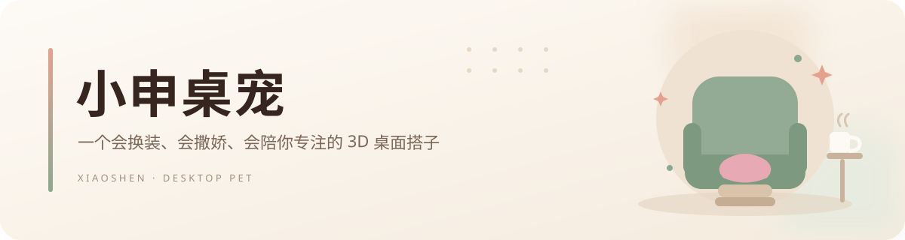

<p align="center">
  
</p>

<p align="center">
  <a href="https://github.com/sakurajh/xiaoshen-pet"></a>
  <a href="https://threejs.org/"></a>
  
  <a href="LICENSE"></a>
</p>

<p align="center">
  <strong>小申桌宠</strong> 是一个常驻 Windows 桌面的 3D 卡通陪伴角色。<br>
  她会换衣服、做小动作、在沙发上打盹，也能陪你用番茄钟专心做事。
</p>

> 本仓库不包含任何人物照片、桌面截图或用户数据。角色的全部几何、材质与动画均由 Three.js 代码程序化生成，不依赖外部模型或贴图文件。

---

## 功能

| 模块 | 能力 |
| --- | --- |
| **3D 角色** | Q 版大头身比例、眼镜、丸子头、抓夹、耳钉、项链与玉镯；待机呼吸、眨眼、眼神跟随、头部与身体点击反馈 |
| **衣橱** | 8 套服装、5 类可独立开关的配饰、正面 / 左侧 / 背面 / 右侧四视角、自动旋转 |
| **动作** | 摸头、戳一下、挥手、跳跃、跳舞、转圈、伸懒腰、点头、害羞、吃东西、比心、大笑、假装生气、打哈欠、头晕、被吓到、欢呼 |
| **睡眠场景** | 鼠尾草绿单人沙发、脚凳、小地毯与粉色毯子；睡觉时盖毯子、放平双腿，醒来回到桌面 |
| **桌面互动** | 可拖到屏幕任意位置；透明区域不挡桌面点击；贴边自动调整面板与气泡；右键快捷菜单 |
| **鼠标手势** | 快速晃动会头晕抗议；连续戳会吓一跳；连续快速换装会喊“别换啦” |
| **陪伴状态** | 心情、精力、饱食、亲密度与相识天数；离线期间状态会自然衰减 |
| **专注工具** | 番茄钟、喝水提醒、日程提醒（Windows 通知）、近 7 天专注记录 |
| **生活功能** | 本地对白、可选 OpenAI 兼容 AI 聊天、中文语音朗读、天气、1080×1350 写真导出 |
| **桌面集成** | 系统托盘、`Ctrl+Shift+X` 显示/隐藏、始终置顶、开机自启、窗口位置记忆 |

### 衣橱清单

浅灰卫衣 · 蓝粉格衬衫 · 香芋紫冲锋衣 · 雾蓝冲锋衣 · 黑灰紫冲锋衣 · 白蟹印花长袖（藏青半裙）· 白蟹工装搭 · 黑色交叉上衣（米色长裤）

配饰：棕色棒球帽、眼镜、耳钉、项链、抓夹。

## 交互速览

| 操作 | 反应 |
| --- | --- |
| 单击头部 / 身体 | 摸头 / 戳一下 |
| 双击角色或对话气泡 | 打开聊天 |
| 按住拖动 | 被拎起来，手脚乱蹬；松手后落地说话 |
| 在角色身上快速晃动鼠标 | 头晕，抗议“别晃啦” |
| 1.4 秒内连续戳 3 次 | 吓一跳，提示眼镜要歪了 |
| 8 秒内连续换装 3 次 | 头晕，抗议“衣柜都要冒烟了” |
| 右键 | 快捷菜单 |
| `Ctrl+Shift+X` | 快速显示 / 隐藏 |
| 托盘菜单 | 显示、隐藏、退出 |

## 快速开始

**环境要求**：Windows 10 / 11，Node.js 20 及以上。

```bash
git clone https://github.com/sakurajh/xiaoshen-pet.git
cd xiaoshen-pet
npm ci
npm start
```

`npm start` 会先用 esbuild 打包渲染进程，再启动 Electron。开发时可以用：

```bash
npm run dev
```

它会监听 `src/renderer` 的变化，自动重新构建并重启应用。

## 打包

```bash
npm run dist
```

产物位于 `release/XiaoShen-Pet-1.0.0.exe`，是免安装的 Windows x64 便携版。

> 当前构建没有数字签名，Windows SmartScreen 可能提示“未知发布者”。确认来源后选择“更多信息 → 仍要运行”即可。

## 测试

```bash
npm run test:unit       # 45 个 node:test 单元测试
npm run test:e2e        # Electron 端到端回归（离屏窗口，不打扰桌面）
npm run test:boundary   # 真实屏幕边界 / 贴边面板 / 气泡收边
npm test                # 单元测试 + 端到端回归
```

端到端测试覆盖 8 套服装、配饰、状态持久化、睡眠沙发、动作、鼠标手势、拖拽、番茄钟、提醒、聊天、AI 本地 mock、写真导出、托盘显隐与渲染性能。视觉检查脚本位于 `tests/visual/`，生成的截图写入 `tests/out/`，该目录已在 `.gitignore` 中排除。

## 项目结构

```text
xiaoshen-pet/
├─ src/
│  ├─ main/                 # Electron 主进程
│  │  ├─ main.js            # 窗口、托盘、IPC、拖拽、AI/天气代理
│  │  ├─ preload.js         # 受限的渲染进程 API
│  │  └─ windowGeometry.js  # 纯函数：可见区域与面板定位
│  └─ renderer/
│     ├─ app.js             # 界面渲染、状态与交互编排
│     ├─ stage.js           # Three.js 舞台、相机、射线拾取
│     ├─ character/         # 程序化角色、几何体与卡通材质
│     ├─ features/          # 衣橱、对白、手势、番茄钟、提醒、天气、状态
│     ├─ index.html
│     └─ styles.css
├─ scripts/                 # 构建、开发启动与图标生成
├─ tests/
│  ├─ unit/                 # 单元测试
│  ├─ e2e.mjs               # 完整 Electron 回归
│  ├─ boundary.mjs          # 屏幕边界与贴边布局
│  ├─ packaged-smoke.mjs    # 打包版冒烟检查
│  └─ visual/               # 可选视觉检查脚本
├─ assets/                  # 应用 / 托盘图标
├─ docs/                    # README 横幅
├─ .gitignore
├─ LICENSE
└─ package.json
```

## 实现笔记

**透明窗口与点击穿透**
窗口是无边框透明的 `840 × 800` BrowserWindow。渲染进程用 Three.js 射线检测判断光标是否落在角色或面板上，再把结果通过 IPC 告诉主进程；主进程调用 `setIgnoreMouseEvents(true, { forward: true })`，让透明区域真正“漏”给桌面。因为 Electron 在穿透状态下转发的是原生 `mousemove`，监听器同时处理了 `mousemove` 和 `pointermove`。

**拖拽与屏幕边界**
拖拽由主进程轮询 `screen.getCursorScreenPoint()` 驱动，避免透明窗口中的指针捕获丢失。窗口本身允许伸出屏幕，约束的是角色在屏幕上的可见锚点，而不是整个透明窗口；相关纯函数集中在 `windowGeometry.js` 并配有单元测试。贴边打开面板时，窗口会自动把面板移入工作区，关闭后回到原位。

**程序化角色**
角色由胶囊体、球体、挤压后的盒体、车削几何与 `ExtrudeGeometry` 组合而成；头发、衣领、口袋、帽子和沙发都是代码生成的。布料纹理、格纹与印花使用 CanvasTexture 在运行时绘制。没有 GLTF / FBX / 贴图资源，因此仓库体积小，也避免了素材版权问题。

**本地优先**
陪伴状态、聊天记录、番茄钟与提醒保存在渲染进程的 `localStorage`；窗口位置、置顶和开机自启设置保存在 Electron `userData/preferences.json`。没有账号系统，也没有遥测。

## 隐私说明

- 仓库与发布产物都不包含人物原照片；`.gitignore` 额外屏蔽了 `*.jpg`、`*.jpeg`、`*.webp` 等图片格式，避免误提交。
- AI 聊天是可选项。接口地址、模型名和 API Key 只保存在本机，请求由本机主进程直接发往你填写的接口；仓库不包含任何密钥，也没有默认密钥。
- 天气数据来自 [Open-Meteo](https://open-meteo.com/)，不需要密钥。
- 写真导出只是调用系统保存对话框写入本地 PNG，不会上传。
- 本应用不收集遥测数据。

## 已知限制

- 仅支持 Windows；便携版未签名。
- AI Key 以明文形式保存在本机 `localStorage`，请不要在共享电脑上填写长期密钥。
- 天气、AI 聊天需要网络；系统通知需要 Windows 通知权限处于开启状态。
- 首次运行会创建本地配置目录；彻底清除数据可删除 `%APPDATA%\小申桌宠`。

## 许可

[MIT](LICENSE) © 2026 sakurajh

角色形象与“小申”名称仅用于个人桌面陪伴项目。
